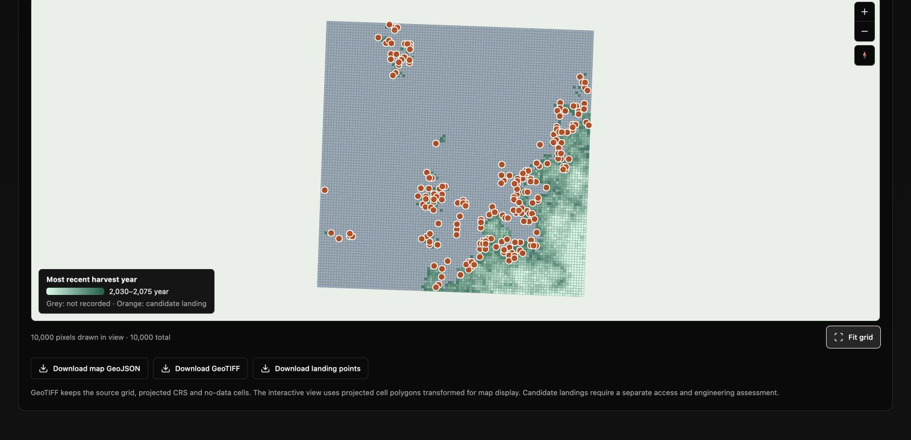

# forestryCastor browser verification

Verified on 2026-11-02, including the public HTTPS deployment.

- Live application: https://projects.ahmadjalil.com/forestryCastor/
- Deployed fork revision: `f6846a18f436b03978175c21eadb48502a3f33b0`
- PGMaps source revision: `bae70897c15dd1444a10dba4538e2841f392cfd7`
- The public [source manifest](https://projects.ahmadjalil.com/forestryCastor/source-manifest.json) reported these exact revisions and a clean host source tree.
- [PGMaps integration PR #72](https://github.com/ahzs645/PGMaps/pull/72) is stacked on [the drought PR #64](https://github.com/ahzs645/PGMaps/pull/64). Publishing the standalone fork did not merge either PR.

## Public browser check

The public application loaded the unchanged original dataCastor SQLite example,
containing 10,000 cells. Its initial lack of harvest targets was visible in the
interface. Through the actual Scenario editor, the check supplied a target of
220,000 m³ per period for all ten five-year periods, then ran the worker.

The resulting report showed:

| Result | Value |
| --- | ---: |
| Harvested volume | 2,194,502.99 m³ |
| Harvested area | 2,077 ha |
| Combined target | 2,200,000 m³ |
| Target shortfall | 5,497.01 m³ |
| Map cells rendered | 10,000 of 10,000 |

The fresh run after reloading the final deployment displayed 2.02 seconds. This is one observed
worker-run duration; it excludes data loading, map rendering and export and is
not a device-independent performance benchmark. The map rendered on the public
deployment, its period/metric and download controls were available, and the
browser error log was empty. Reloading restored the ten explicit target rows
from the local draft; a fresh calculation regenerated the result.

These are demonstration outputs using a tutorial dataset and an explicitly
constructed scenario. The coordinates do not establish an operational inventory
or a management recommendation. Landing markers are planning candidates.



## Data loading and CORS

A real anonymous **GET**, with the header
`Origin: https://pgmaps.ahmadjalil.com`, was sent to:

https://projects.ahmadjalil.com/forestryCastor/data/forestry-castor/simple_castordb.sqlite

At 09:51 UTC on 2026-11-02, the response included:

```http
HTTP/2 200
access-control-allow-origin: *
content-type: application/octet-stream
content-length: 696320
cache-control: max-age=600
```

The downloaded body matched SHA-256:

```text
8d19a48acba51de568d6994b8b41c0d9b6d3533aa6ea8c7a0e3cd95afe23535d
```

This permits a non-credentialed browser GET from the PGMaps origin at the time
of the check. It is a check of this exact published asset, not a blanket claim
about other provincial or climate-data endpoints. The workbench itself serves
the sample, compiled worker and SQLite Wasm from its own origin. Local imports,
calculations and downloads need no CORS proxy or remote calculation service.

## Automated verification

- [PGMaps general Checks](https://github.com/ahzs645/PGMaps/actions/runs/41423259807):
  TypeScript, lint, formatting and **2,976 tests passed; one skipped** across
  389 passing test files and one skipped file. This includes 103 Castor tests.
- [PGMaps Castor acceptance](https://github.com/ahzs645/PGMaps/actions/runs/41423259769):
  source/SQLite/independent SQL fixtures, 103 Castor tests, production builds,
  five real browser cases on the integrated route and the same five cases
  under the standalone URL.
- [Fork build and deployment](https://github.com/ahzs645/forestryCastor/actions/runs/41423353159):
  all 28 mirrored source hashes, source fixtures, 103 tests, standalone
  TypeScript/build/artifact checks, five production browser cases, and Pages
  deployment passed.
- [Fork browser evidence](https://github.com/ahzs645/forestryCastor/actions/runs/41423353159/artifacts/13130782691).

The browser cases exercise the actual compiled worker, original SQLite/Wasm,
same-origin loading, strict CSP, map rendering, CSV/ZIP/session and
GeoJSON/Float64 GeoTIFF downloads, raster reimport, comparisons, local recovery,
invalid input and phone layout. No calculations or source data are mocked.

## Model scope

The [implementation contract](https://github.com/ahzs645/PGMaps/blob/bae70897c15dd1444a10dba4538e2841f392cfd7/docs/forestry-castor.md)
and [source audit](https://github.com/ahzs645/PGMaps/blob/bae70897c15dd1444a10dba4538e2841f392cfd7/docs/forestry-castor-source-audit.md)
record the upstream mappings and deliberate browser changes. Independent
reference checks use the original SQL and supplied yield knots. Full R/SpaDES
numerical equivalence has not been established. Yield sensitivity is explicitly
uncalibrated; the absent gamma calibration and external Java engine are not
represented as completed ports.

